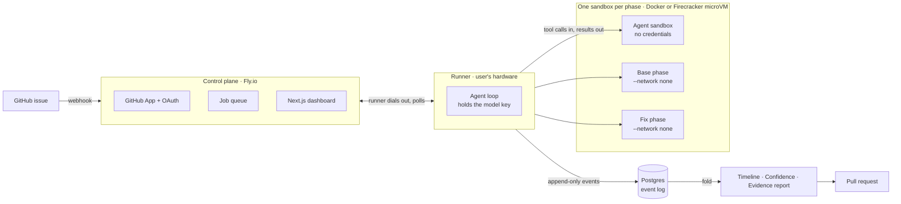

# Repro

**Open a GitHub issue. Get back a pull request that proves the bug was there before the change, and gone after it.**

[](https://github.com/Divy97/Repro/actions/workflows/check.yml)


**Live:** https://test-framework.fly.dev · **A real PR it opened:** [Divy97/test-framework-v2-demo#4](https://github.com/Divy97/test-framework-v2-demo/pull/4)

---

## The problem

AI coding agents write fixes quickly, and explain them convincingly. Neither tells you the fix is right. Reviewing an agent's pull request today means trusting its account of what it did.

Repro is not another coding agent. It is the **verification system around one**. The agent writes the fix; Repro decides whether to believe it, using only what it executed itself.

## How a run works

1. **Reproduce first.** A test must fail on the original commit, showing the symptom the reporter described.
2. **Then fix.** The agent works in a sandbox with no network and no credentials.
3. **Then prove it.** The same test passes on the fix, and the project's own suite runs on *both* commits, so a fix that repairs one bug and breaks forty tests is reported, not shipped.
4. **No reproduction, no fix.** If step 1 fails, no patch is attempted. The reporter gets one question about the missing detail instead.

Every claim in the pull request is an exit code Repro ran itself, in a container the agent could not reach. The agent's transcript is shown, never trusted.

| Confidence tier | Meaning |
| --- | --- |
| **Tier 1** | Reproduced by a test whose independence is established |
| **Tier 2** | Reproduced; independence unverified (an agent-written test lands here) |
| **Tier 3** | Not reproduced, so **no fix is attempted** |

**A real result:** an issue filed on the demo repository came back as [a pull request](https://github.com/Divy97/test-framework-v2-demo/pull/4) through a live GitHub webhook. Tier 2, red on base twice with the reported symptom, green three times on the fix, the project suite green on both commits. **95 seconds, $0.06.**

## Architecture



## Engineering highlights

- **Event-sourced, with no runs table.** A run is an append-only log in Postgres. Its state exists only as a fold over its events, and every screen is a disposable projection. `npm run rebuild` drops the read model and replays the log into byte-identical rows.
- **The judged party never holds a credential.** The agent loop runs *outside* the sandbox and sends tool calls in, so the sandbox needs no network egress at all. The host clones, pushes and opens the PR. The agent's only output is a commit.
- **One sealed container per phase.** Base and fix run in fresh containers with `--network none` and no shared filesystem, because four rounds of adversarial review showed that a shared filesystem was enough to fake a result.
- **Isolation is verified, not assumed.** On the microVM backend, each sandbox is created deny-all and then *probed from inside* (DNS over UDP and TCP, TLS, HTTP), because the platform's policy readback is not evidence that the policy was applied.
- **A split built for real networks.** A laptop cannot receive a webhook, so a control plane holds the stable address and the GitHub App key, and a runner dials out from the user's own hardware. The plane executes nothing and never spends a model key.
- **The model is a replaceable part.** One tool surface, two wire formats: the Anthropic SDK and an OpenAI-shaped loop over OpenRouter (~336 tool-capable models). Models that cannot make structured tool calls are refused before the run.
- **Tested adversarially.** 1,000+ tests, including a suite of hostile fixtures that try to forge results, escape the workspace, plant hooks, survive teardown and reach the network. CI runs them against real containers and a real Postgres.

## Tech stack

| Layer | Technology |
| --- | --- |
| Engine and runner | TypeScript (strict), Node.js 22 |
| Event store | PostgreSQL (Neon in production) |
| Dashboard | Next.js 15, React 19, server-sent events for live logs |
| Sandboxing | Docker locally, Vercel Sandbox (Firecracker microVMs) when hosted |
| Hosting | Fly.io: control plane and worker |
| Integrations | GitHub App (webhooks, PRs, comments), GitHub OAuth |
| Models | Anthropic SDK, OpenRouter |
| Testing and CI | Vitest, headless Chromium, GitHub Actions |

## Run it locally

Requires Node.js 22+ and Docker.

```bash
npm ci
cp .env.example .env              # set POSTGRES_PASSWORD and DATABASE_URL
docker compose up -d postgres
npm run db:apply                  # apply the event-store schema
npm run images                    # build the sandbox and agent images
DATABASE_URL=postgres://postgres:<password>@127.0.0.1:5432/events npx vitest run
```

The suite never reads `.env`, and it refuses a `DATABASE_URL` that is not on this machine. No model key is needed: agents are scripted in tests. The queue tests only run with `ENGINE_TEST_QUEUE=1`, so they cannot race a live worker. `.env.example` documents every other setting: the model provider, the GitHub App, the executor.

## Repository layout

```
src/        engine: orchestrator, runner, executors, event store, fold, verification, GitHub App
web/        Next.js dashboard
prompts/    the reproduction and fix prompts the agent receives
demo/       a small service with seeded bugs, used for end-to-end runs
test/       unit, integration, adversarial sandbox and browser tests
docs/adr/   22 architecture decision records
```

## Status and limitations

The engine works end to end and has opened real pull requests from real webhooks. Known limits, stated plainly:

- An agent-written reproduction is capped at **Tier 2**. Proving it independent needs diff coverage, which is not built yet.
- The evidence store is append-only by convention, not by construction.
- Documented real-model runs cover one of the demo's seeded bugs. The others are exercised by scripted agents.

## Further reading

- [Deep dive](docs/deep-dive.md): the full design, including what each milestone got wrong and how it was found
- [Architecture](docs/architecture-v1.5.md)
- [Decision records](docs/adr/): why event sourcing, why Postgres over Kafka, why the agent loop runs outside the sandbox, and 19 more
